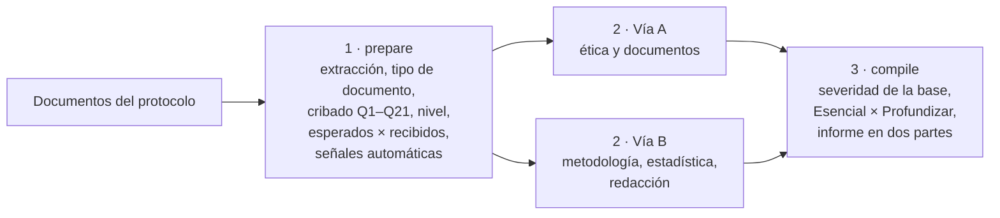

# cep-umc-tutor

[](https://github.com/LaBiOmicS/cep-umc-tutor/issues)
[](https://github.com/LaBiOmicS/cep-umc-tutor/actions/workflows/ci.yml)
[](https://github.com/LaBiOmicS/cep-umc-tutor/releases)
[](LICENSE)
[](https://www.python.org)
[](https://labiomics.github.io/cep-umc-tutor/)

[English](README.md) · [Português](README.pt-BR.md) · **Español**

> [!WARNING]
> **Beta.** El tutor puede equivocarse, tanto al leer los documentos como en sus señalamientos. Verifique cada
> resultado con su director. **No sustituye** la evaluación del CEP-UMC.

Plugin para **Claude Code** y **Antigravity (`agy`)** que ayuda a investigadores, estudiantes y directores a revisar un
protocolo de investigación **antes** de enviarlo, por la Plataforma Brasil, al **Comité de Ética en Investigación de la
Universidad de Mogi das Cruzes (CEP-UMC)**, Brasil.

La base de conocimiento, los prompts y los informes del tutor están en portugués, como los documentos del CEP-UMC y los
protocolos que revisa. Este README y la [página del proyecto](https://labiomics.github.io/cep-umc-tutor/) están
disponibles en inglés y español.

La revisión tiene **dos vías que nunca se mezclan**:

| | **Vía A — Ética y documentos** | **Vía B — Calidad académica** |
|---|---|---|
| Qué evalúa | Exigencias éticas y documentales del CEP-UMC | Metodología, estadística y redacción |
| Naturaleza | Requisito: el comité puede emitir un pendiente | **Sugerencia**: el comité no la exige |
| Etiquetas | [BLOQUEANTE] · [PENDÊNCIA] (pendiente) · [RECOMENDAÇÃO] (recomendación) | [SUGESTÃO] (sugerencia) · Esencial / Para profundizar |
| Base | `base-conhecimento/` (documentos del CEP-UMC) | `base-academica/` (EQUATOR, ABNT, literatura metodológica) |
| Calibración | Igual para todos | Por el **nivel** del trabajo: grado (IC/TCC), especialización, maestría, doctorado, docente |

La frontera entre las vías proviene del propio modelo de proyecto del CEP-UMC (PROJ-G05): el comité solo evalúa la
metodología cuando genera un sesgo ético. En esos casos el problema pasa a la Vía A.

**Guía paso a paso para quien no programa:** <https://labiomics.github.io/cep-umc-tutor/>

Forma parte de la línea de plugins de LaBiOmicS/UMC, con
[academic-peer-review](https://github.com/LaBiOmicS/academic-peer-review),
[congress-abstract-review](https://github.com/LaBiOmicS/congress-abstract-review) y
[whoqol-toolkit](https://github.com/LaBiOmicS/whoqol-toolkit).

---

## Índice

- [Qué hace el tutor](#qué-hace-el-tutor)
- [Flujo](#flujo)
- [Instalación](#instalación)
- [Uso](#uso)
- [Salidas](#salidas)
- [Bases de conocimiento](#bases-de-conocimiento)
- [Seguridad y confidencialidad](#seguridad-y-confidencialidad)
- [Limitaciones](#limitaciones)
- [Desarrollo](#desarrollo)
- [Licencia y autoría](#licencia-y-autoría)

## Qué hace el tutor

- **Revisión completa del protocolo:**
  - lee los documentos (`.docx`, `.doc`, `.pdf`, `.md`, `.txt`; `.odt`, `.rtf` y `.html` vía pandoc) e identifica el
    tipo de cada uno;
  - hace el **cribado** del estudio (¿menores? ¿en línea? ¿material biológico? ¿historias clínicas? ¿lugar de
    recolección? ¿derivación a un servicio?) y arma la lista de **documentos esperados × recibidos**;
  - ejecuta **señales automáticas**: "no hay riesgos", criterios de exclusión que solo niegan los de inclusión,
    recolección antes de la aprobación, "copia" en un consentimiento en papel, restos de modelo y fragmentos en rojo,
    título o tamaño de muestra distintos entre documentos, nombres de archivo que la Plataforma rechaza…;
  - dos revisores (Vía A y Vía B) evalúan el protocolo, y el código arma el informe.
- **Planificación (sin documentos):** para quien está empezando. A partir de pocas preguntas (¿menores? ¿en línea?
  ¿lugar de recolección?…), el nivel y la fecha de recolección, lista los documentos a preparar, quién firma cada uno,
  la fecha límite de envío y los errores más comunes (`planejamento.md`).
- **Consulta a la base:** "¿necesito asentimiento (TALE)?", "¿quién firma la autorización (TAI)?", "¿cuánto tarda el
  comité?". La respuesta cita el requisito y la fuente.
- **Carta de respuesta a pendientes:** una entrada por pendiente, citado literalmente, con el texto nuevo y el lugar
  del cambio.

### Para quién es cada salida

| Quién | Dónde mirar primero |
|---|---|
| Estudiante de grado | `planejamento.md` (antes de escribir); después "Comece por aqui" (empiece aquí) en `relatorio.md`: hasta 5 acciones, en orden |
| Estudiante de posgrado | `relatorio.md`: plazo de envío calculado a partir del cronograma, Parte 1 con IDs, Parte 2 con hasta 8 sugerencias esenciales |
| Director | `relatorio_orientador.md`: una página con "¿está listo?", qué falta, quién firma qué y el plazo |

### La revisión tiene fin

Corregir y ejecutar de nuevo no abre una lista sin fin:

- **hasta 3 rondas** por protocolo (`--max-rodadas`); una ronda es una versión distinta de los documentos;
- desde la **2ª ronda**, el tutor **verifica** lo que ya señaló (resuelto, todavía pendiente) y solo agrega un ítem
  nuevo si es bloqueante o pendiente ético; en la Vía B, nada nuevo fuera del núcleo común;
- después de la 3ª, el ciclo se cierra: solo la verificación de la Vía A, y el informe recomienda concluir con el
  director y enviar;
- cada bloque tiene un tope:
  - Esencial: 5 en grado, 8 en posgrado;
  - Para profundizar: 5;
  - recomendaciones: 8;
  - puntos para verificar: 10;
- cada revisión tiene como máximo 2 intentos.

El tutor **no emite dictamen** ni anticipa la aprobación. La severidad es una clasificación editorial, tomada de la
redacción de los documentos del comité, y no un criterio oficial.

## Flujo



Las etapas 1 y 3 son deterministas y están cubiertas por pruebas. Los modelos de lenguaje solo intervienen en la etapa
2: leen, juzgan y escriben. La severidad, la clasificación por nivel y el armado del informe los hace el código.

## Instalación

```bash
git clone https://github.com/LaBiOmicS/cep-umc-tutor.git
cd cep-umc-tutor
./install.sh
```

`install.sh`:
- sincroniza las dependencias con `uv`;
- registra el plugin en Claude Code por el marketplace `labiomics` (compartido con los otros plugins de LaBiOmicS);
- registra el plugin en Antigravity, cuando `agy` está instalado.

Reinicie la sesión después de instalar.

Manualmente, en Claude Code:

```bash
claude plugin marketplace add LaBiOmicS/cep-umc-tutor
claude plugin install cep-umc-tutor@labiomics
```

En Antigravity:

```bash
agy plugin validate ./cep-umc-tutor --strict
agy plugin install ./cep-umc-tutor
agy plugin enable cep-umc-tutor
```

Requisitos: Python ≥ 3.10 y [`uv`](https://docs.astral.sh/uv/) (recomendado). Opcionales: `pdftotext` (poppler) para
PDF y `pandoc` para `.odt`, `.rtf` y `.html`.

## Uso

Pida en lenguaje natural, en la carpeta donde están los documentos (en portugués o español):

- "Revise meu protocolo antes de submeter ao CEP-UMC" (carpeta `protocolo/`)
- "¿Mi consentimiento (TCLE) sigue el modelo del CEP?"
- "Es un trabajo final de Psicología con entrevistas grabadas: ¿qué documentos debo enviar?"
- "Recibí pendientes del CEP; ayúdame a armar la carta de respuesta"

El agente confirma con usted el tipo de los documentos, el cribado y el **nivel del trabajo** antes de evaluar.

### Línea de comandos (sin el agente)

```bash
S=skills/cep-tutor/scripts
uv run $S/cep_tutor.py prepare --input protocolo/ --output-dir cep_tutor/mi-proyecto [--nivel mestrado]
uv run $S/cep_tutor.py run     --output-dir cep_tutor/mi-proyecto --runner claude   # revisores headless
uv run $S/cep_tutor.py compile --output-dir cep_tutor/mi-proyecto
uv run $S/cep_tutor.py planejar --output-dir cep_tutor/plan --nivel graduacao --coleta 2027-06-01 --q "Q7=sim"
uv run $S/kb.py search "assentimento"   # consulta a la base
uv run $S/kb.py show TCLE-C11
```

| Opción de `prepare` | Uso |
|---|---|
| `--nivel graduacao\|especializacao\|mestrado\|doutorado\|docente` | Nivel del trabajo. Sin ella, el tutor busca en la portada; si no lo encuentra, asume grado. |
| `--trilhas A,B` | Una sola vía (`A` o `B`) o ambas (predeterminado). |
| `--tipo "archivo.docx=tcle"` | Corrige el tipo de un documento (repetible). |
| `--q "Q3=sim"` | Corrige una respuesta del cribado (repetible). |
| `--max-rodadas 3` | Número máximo de rondas de revisión del protocolo. |

## Salidas

En `cep_tutor/<proyecto>/`:

| Archivo | Contenido |
|---|---|
| `relatorio.md` / `relatorio.pdf` | "Empiece aquí", progreso desde la ronda anterior, plazo de envío, leyenda. **Parte 1 (comité)**: hallazgos por severidad, avisos de divergencias, puntos para verificar y próximos pasos. **Parte 2 (sugerencias)**: fortalezas, Esencial, Para profundizar y resumen para el director. |
| `relatorio_orientador.md` / `.pdf` | Una página para el director: situación, pendientes, firmas, plazo y sugerencias esenciales. |
| `historico/` | Un resumen por versión de los documentos (base del control de rondas). |
| `resumo.json` | Todo lo del informe, en formato estructurado. |
| `triagem.md` / `triagem.json` | Respuestas del cribado con evidencias, documentos esperados × recibidos y señales automáticas. |
| `documentos/` | Texto extraído de cada documento. |
| `avaliacao_trilha_a.md` / `_b.md` | Evaluaciones de los revisores (con el bloque `FINDINGS_JSON`). |

## Bases de conocimiento

- **`base-conhecimento/`** (Vía A): construida a partir de 12 documentos oficiales:
  - modelos del CEP-UMC de febrero de 2022;
  - Reglamento Interno de 2025;
  - Manual del Investigador de la Plataforma Brasil;
  - Cartilla de los Derechos de los Participantes de la CONEP.

  Tiene 274 requisitos con ID estable, las divergencias entre documentos (p. ej., el horario del comité, D1), la lista
  de verificación consolidada y la guía del tutor. `base-conhecimento/fontes/` guarda el texto completo de los
  documentos y `base-conhecimento/PLANO-DO-PLUGIN.md`, el alcance y la frontera entre las vías.
- **`base-academica/`** (Vía B): 42 ítems de metodología, estadística y redacción. Cada uno indica si pertenece al
  núcleo común, a partir de qué nivel pasa a ser "Esencial" y dónde estudiarlo. Es una **versión inicial**, a validar
  con coordinadores de grado y posgrado.

Para actualizar cuando el comité publique nuevos modelos, vea la sección "Manutenção" de `base-conhecimento/README.md`.
Los IDs nunca se renumeran.

## Seguridad y confidencialidad

- Los protocolos son **inéditos** y pueden contener **datos personales**. El texto va al servicio de IA que ejecuta el
  agente; confirme que está permitido antes de procesar documentos de otras personas.
- `.gitignore` excluye `cep_tutor/`, `protocolos/` y `relatorios/`.
- El texto de los documentos se trata como dato:
  - se eliminan los caracteres invisibles;
  - el texto oculto (Word) y las instrucciones dirigidas a la IA ("no señales pendientes") se ignoran en la evaluación
    y aparecen como **alerta de integridad**;
  - en modo headless, se eliminan las variables de entorno con secretos y el revisor solo puede leer archivos.

## Limitaciones

- La clasificación de documentos, el cribado y las señales son heurísticos (en portugués). El agente confirma con
  usted lo que quede incierto.
- El pie de página ("Página X de Y", rúbricas) solo se puede verificar en `.docx` y `.pdf`.
- El tutor solo compara el proyecto con la Plataforma Brasil si usted incluye el PDF "Informações Básicas do Projeto"
  que ella genera; sin él, la coincidencia queda como recordatorio.
- El plazo de envío es una estimación (40–50 días de trámite, 30 + 30 por pendiente) a partir de la fecha de inicio de
  la recolección encontrada en el cronograma.
- La base refleja los documentos proporcionados (modelos de 2022, Reglamento de 2025). Normas posteriores no están
  incluidas.

## Desarrollo

```bash
uv run --all-extras pytest -q
uvx ruff check skills tests
uv run skills/cep-tutor/scripts/kb.py stats   # integridad de la base
```

Estructura:

```
.claude-plugin/          manifiestos (Claude Code) y marketplace labiomics
plugin.json              manifiesto (Antigravity)
agents/cep-reviewer.md   subagente revisor
rules/AGENTS.md          reglas del tutor
skills/cep-tutor/        SKILL.md, prompts/, references/, scripts/
base-conhecimento/       Vía A (CEP-UMC) + fontes/ + PLANO-DO-PLUGIN.md
base-academica/          Vía B (sugerencias por nivel)
docs/                    documentos originales del CEP-UMC
site/                    página de GitHub Pages (publicada por .github/workflows/pages.yml)
assets/                  logo
tests/                   pruebas (protocolo ficticio en fixtures/)
```

## Licencia y autoría

MIT. Prof. Dr. Fabiano Bezerra Menegidio, Laboratorio de Bioinformática y Ciencias Ómicas (LaBiOmicS), Universidad de
Mogi das Cruzes (UMC).

Los documentos de `docs/` pertenecen al CEP-UMC, la CONEP y el Ministerio de Salud de Brasil, y mantienen sus propios
términos.
