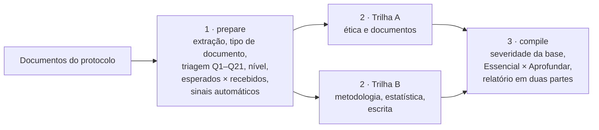

# cep-umc-tutor

[](https://github.com/LaBiOmicS/cep-umc-tutor/issues)
[](https://github.com/LaBiOmicS/cep-umc-tutor/actions/workflows/ci.yml)
[](https://github.com/LaBiOmicS/cep-umc-tutor/releases)
[](LICENSE)
[](https://www.python.org)
[](https://labiomics.github.io/cep-umc-tutor/)

[English](README.md) · **Português** · [Español](README.es.md)

> [!WARNING]
> **Beta.** O tutor pode errar, tanto ao ler os documentos quanto nos apontamentos. Confira cada resultado com o
> orientador. Ele **não substitui** a avaliação do CEP-UMC.

Plugin para **Claude Code** e **Antigravity (`agy`)** que ajuda pesquisadores, alunos e orientadores a revisar um
protocolo de pesquisa **antes** de submetê-lo ao **Comitê de Ética em Pesquisa da Universidade de Mogi das Cruzes
(CEP-UMC)** pela Plataforma Brasil.

A revisão tem **duas trilhas que nunca se misturam**:

| | **Trilha A — Ética e documentos** | **Trilha B — Qualidade acadêmica** |
|---|---|---|
| O que avalia | Exigências éticas e documentais do CEP-UMC | Metodologia, estatística e escrita |
| Natureza | Requisito: o CEP pode emitir pendência | **Sugestão**: não é cobrada pelo CEP |
| Rótulos | [BLOQUEANTE] · [PENDÊNCIA] · [RECOMENDAÇÃO] | [SUGESTÃO] · Essencial / Para aprofundar |
| Base | `base-conhecimento/` (documentos do CEP-UMC) | `base-academica/` (EQUATOR, ABNT, literatura metodológica) |
| Calibração | Igual para todos | Pelo **nível** do trabalho: graduação (IC/TCC), especialização, mestrado, doutorado, docente |

A fronteira entre as trilhas vem do próprio modelo de projeto do CEP-UMC (PROJ-G05): o CEP só avalia a metodologia
quando ela gera viés ético. Nesses casos o problema vai para a Trilha A.

**Guia passo a passo para quem não programa:** <https://labiomics.github.io/cep-umc-tutor/>

Faz parte da linha de plugins do LaBiOmicS/UMC, com o
[academic-peer-review](https://github.com/LaBiOmicS/academic-peer-review), o
[congress-abstract-review](https://github.com/LaBiOmicS/congress-abstract-review) e o
[whoqol-toolkit](https://github.com/LaBiOmicS/whoqol-toolkit).

---

## Sumário

- [O que o tutor faz](#o-que-o-tutor-faz)
- [Fluxo](#fluxo)
- [Instalação](#instalação)
- [Uso](#uso)
- [Saídas](#saídas)
- [Bases de conhecimento](#bases-de-conhecimento)
- [Segurança e confidencialidade](#segurança-e-confidencialidade)
- [Limitações](#limitações)
- [Desenvolvimento](#desenvolvimento)
- [Licença e autoria](#licença-e-autoria)

## O que o tutor faz

- **Revisão completa do protocolo:**
  - lê os documentos (`.docx`, `.doc`, `.pdf`, `.md`, `.txt`; `.odt`, `.rtf` e `.html` via pandoc) e identifica o tipo
    de cada um;
  - faz a **triagem** do estudo (menores? online? material biológico? prontuários? local de coleta? encaminhamento a
    serviço?) e monta a lista de **documentos esperados × recebidos**;
  - roda **sinais automáticos**: "não há riscos", exclusão como antítese da inclusão, coleta antes da aprovação, "cópia"
    num TCLE em papel, restos de modelo e trechos em vermelho, título ou amostra diferentes entre documentos, nomes de
    arquivo recusados pela Plataforma…;
  - dois revisores (Trilha A e Trilha B) avaliam o protocolo, e o código monta o relatório.
- **Planejamento (sem documentos):** para quem está começando. A partir de poucas perguntas (menores? online? local
  de coleta?…), o nível e a data da coleta, lista os documentos a preparar, quem assina cada um, a data-limite de
  submissão e os erros mais comuns (`planejamento.md`).
- **Consulta à base:** "preciso de TALE?", "quem assina o TAI?", "quanto tempo o CEP leva?". A resposta cita o
  requisito e a fonte.
- **Carta-resposta a pendências:** uma entrada por pendência, copiada literalmente, com o texto novo e o local da
  alteração.

### Para quem é cada saída

| Quem | Onde olhar primeiro |
|---|---|
| Aluno de graduação | `planejamento.md` (antes de escrever); depois "Comece por aqui" no `relatorio.md`: até 5 ações, em ordem |
| Aluno de pós | `relatorio.md`: prazo de submissão calculado pelo cronograma, Parte 1 com IDs, Parte 2 com até 8 sugestões essenciais |
| Orientador | `relatorio_orientador.md`: uma página com "está pronto?", o que falta, quem assina o quê e o prazo |

### A avaliação é finita

Corrigir e rodar de novo não abre uma lista sem fim:

- **até 3 rodadas** por protocolo (`--max-rodadas`); uma rodada é uma versão diferente dos documentos;
- da **2ª rodada** em diante, o tutor **verifica** o que já apontou (resolvido, ainda pendente) e só acrescenta item
  novo se for bloqueante ou pendência ética; na Trilha B, nada novo fora do núcleo comum;
- depois da 3ª, o ciclo se encerra: só a verificação da Trilha A, e o relatório recomenda concluir com o orientador e
  submeter;
- cada bloco tem teto:
  - Essencial: 5 na graduação, 8 na pós;
  - Para aprofundar: 5;
  - recomendações: 8;
  - pontos para conferir: 10;
- cada revisão tem no máximo 2 tentativas.

O tutor **não emite parecer** e não prevê aprovação. A severidade é uma classificação editorial, tirada da redação dos
documentos do CEP, e não um critério oficial.

## Fluxo



As etapas 1 e 3 são determinísticas e cobertas pelos testes. Os modelos de linguagem só entram na etapa 2: leem,
julgam e escrevem. A severidade, a classificação por nível e a montagem do relatório são feitas pelo código.

## Instalação

```bash
git clone https://github.com/LaBiOmicS/cep-umc-tutor.git
cd cep-umc-tutor
./install.sh
```

O `install.sh`:
- sincroniza as dependências com o `uv`;
- registra o plugin no Claude Code pelo marketplace `labiomics` (o mesmo dos outros plugins LaBiOmicS);
- registra o plugin no Antigravity, quando o `agy` estiver instalado.

Reinicie a sessão depois de instalar.

Manualmente, no Claude Code:

```bash
claude plugin marketplace add /caminho/para/cep-umc-tutor
claude plugin install cep-umc-tutor@labiomics
```

Requisitos: Python ≥ 3.10 e [`uv`](https://docs.astral.sh/uv/) (recomendado). Opcionais: `pdftotext` (poppler) para
PDFs e `pandoc` para `.odt`, `.rtf` e `.html`.

## Uso

Peça em linguagem natural, na pasta onde estão os documentos:

- "Revise meu protocolo antes de submeter ao CEP-UMC" (pasta `protocolo/`)
- "Meu TCLE está de acordo com o modelo do CEP?"
- "É um TCC de Psicologia com entrevistas gravadas: que documentos preciso enviar?"
- "Recebi pendências do CEP; me ajude a montar a carta-resposta"

O agente confirma com você o tipo dos documentos, a triagem e o **nível do trabalho** antes de avaliar.

### Linha de comando (sem o agente)

```bash
S=skills/cep-tutor/scripts
uv run $S/cep_tutor.py prepare --input protocolo/ --output-dir cep_tutor/meu-projeto [--nivel mestrado]
uv run $S/cep_tutor.py run     --output-dir cep_tutor/meu-projeto --runner claude   # revisores headless
uv run $S/cep_tutor.py compile --output-dir cep_tutor/meu-projeto
uv run $S/cep_tutor.py planejar --output-dir cep_tutor/plano --nivel graduacao --coleta 2027-06-01 --q "Q7=sim"
uv run $S/kb.py search "assentimento"   # consulta à base
uv run $S/kb.py show TCLE-C11
```

| Opção de `prepare` | Uso |
|---|---|
| `--nivel graduacao\|especializacao\|mestrado\|doutorado\|docente` | Nível do trabalho. Sem ele, o tutor procura na capa; se não achar, assume graduação. |
| `--trilhas A,B` | Só uma trilha (`A` ou `B`) ou as duas (padrão). |
| `--tipo "arquivo.docx=tcle"` | Corrige o tipo de um documento (repetível). |
| `--q "Q3=sim"` | Corrige uma resposta da triagem (repetível). |
| `--max-rodadas 3` | Número máximo de rodadas de revisão para o protocolo. |

## Saídas

Em `cep_tutor/<projeto>/`:

| Arquivo | Conteúdo |
|---|---|
| `relatorio.md` / `relatorio.pdf` | "Comece por aqui", progresso desde a rodada anterior, prazo de submissão, legenda. **Parte 1 (CEP)**: achados por severidade, avisos de divergência, pontos para conferir e próximos passos. **Parte 2 (sugestões)**: pontos fortes, Essencial, Para aprofundar e resumo para o orientador. |
| `relatorio_orientador.md` / `.pdf` | Uma página para o orientador: situação, pendências, assinaturas, prazo e sugestões essenciais. |
| `historico/` | Um resumo por versão dos documentos (base do controle de rodadas). |
| `resumo.json` | Tudo o que está no relatório, em formato estruturado. |
| `triagem.md` / `triagem.json` | Respostas da triagem com evidências, documentos esperados × recebidos e sinais automáticos. |
| `documentos/` | Texto extraído de cada documento. |
| `avaliacao_trilha_a.md` / `_b.md` | Avaliações dos revisores (com o bloco `FINDINGS_JSON`). |

## Bases de conhecimento

- **`base-conhecimento/`** (Trilha A): construída a partir de 12 documentos oficiais:
  - modelos do CEP-UMC de fevereiro de 2022;
  - Regimento Interno de 2025;
  - Manual do Pesquisador da Plataforma Brasil;
  - Cartilha dos Direitos dos Participantes da CONEP.

  Tem 274 requisitos com ID estável, as divergências entre os documentos (ex.: o horário do CEP, D1), o checklist
  consolidado e o guia do tutor. `base-conhecimento/fontes/` guarda o texto integral dos documentos e
  `base-conhecimento/PLANO-DO-PLUGIN.md`, o escopo e a fronteira entre as trilhas.
- **`base-academica/`** (Trilha B): 42 itens de metodologia, estatística e escrita. Cada um indica se é do núcleo comum,
  a partir de qual nível passa a ser "Essencial" e onde estudar. É uma **versão inicial**, a validar com coordenadores
  de curso e de pós-graduação.

Para atualizar quando o CEP publicar novos modelos, veja a seção "Manutenção" de `base-conhecimento/README.md`. Os
IDs nunca são renumerados.

## Segurança e confidencialidade

- Protocolos são **inéditos** e podem conter **dados pessoais**. O texto vai para o serviço de IA que executa o
  agente; confirme que isso é permitido antes de processar documentos de outras pessoas.
- `.gitignore` exclui `cep_tutor/`, `protocolos/` e `relatorios/`.
- O texto dos documentos é tratado como dado:
  - caracteres invisíveis são removidos;
  - texto oculto (Word) e instruções dirigidas a IA ("não aponte pendências") são ignorados na avaliação e aparecem
    como **alerta de integridade**;
  - no modo headless, as variáveis de ambiente com segredos são removidas e o revisor só pode ler arquivos.

## Limitações

- A classificação dos documentos, a triagem e os sinais são heurísticos (em português). O agente confirma com você o
  que ficar incerto.
- O rodapé ("Página X de Y", rubricas) só é verificável em `.docx` e `.pdf`.
- O tutor só compara o projeto com a Plataforma Brasil se você incluir o PDF "Informações Básicas do Projeto" gerado
  por ela; sem ele, a igualdade fica como lembrete.
- O prazo de submissão é estimado (40–50 dias de tramitação, 30 + 30 por pendência) a partir da data de início da coleta
  encontrada no cronograma.
- A base reflete os documentos fornecidos (modelos de 2022, Regimento de 2025). Normas posteriores não estão incluídas.

## Desenvolvimento

```bash
uv run --all-extras pytest -q
uvx ruff check skills tests
uv run skills/cep-tutor/scripts/kb.py stats   # integridade da base
```

Estrutura:

```
.claude-plugin/          manifestos (Claude Code) e marketplace labiomics
plugin.json              manifesto (Antigravity)
agents/cep-reviewer.md   subagente revisor
rules/AGENTS.md          regras do tutor
skills/cep-tutor/        SKILL.md, prompts/, references/, scripts/
base-conhecimento/       Trilha A (CEP-UMC) + fontes/ + PLANO-DO-PLUGIN.md
base-academica/          Trilha B (sugestões por nível)
docs/                    documentos originais do CEP-UMC
site/                    página do GitHub Pages (publicada por .github/workflows/pages.yml)
assets/                  logo
tests/                   testes (protocolo fictício em fixtures/)
```

## Licença e autoria

MIT. Prof. Dr. Fabiano Bezerra Menegidio, Laboratório de Bioinformática e Ciências Ômicas (LaBiOmicS), Universidade de
Mogi das Cruzes (UMC).

Os documentos em `docs/` são do CEP-UMC, da CONEP e do Ministério da Saúde, e mantêm seus próprios termos.
